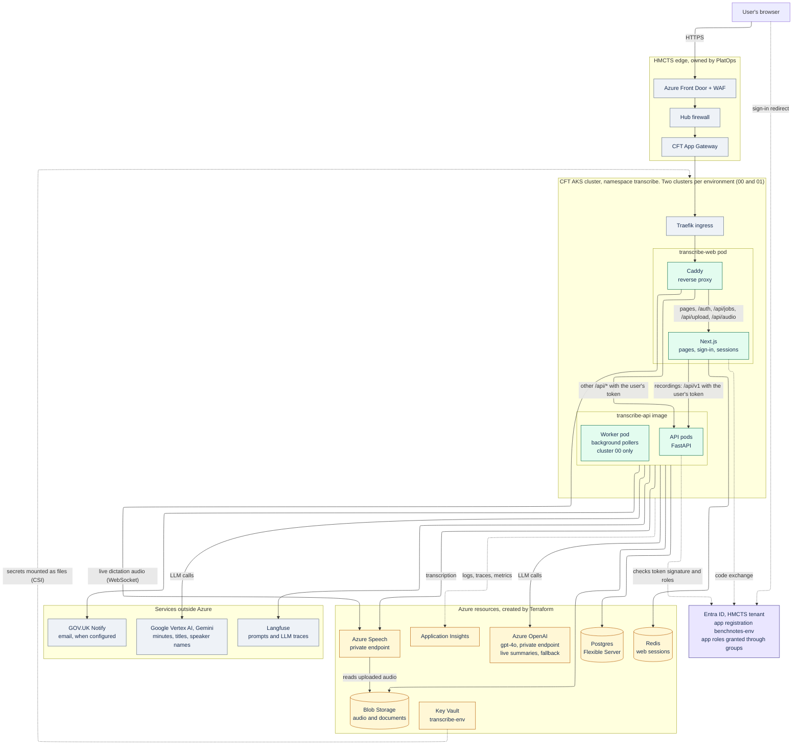
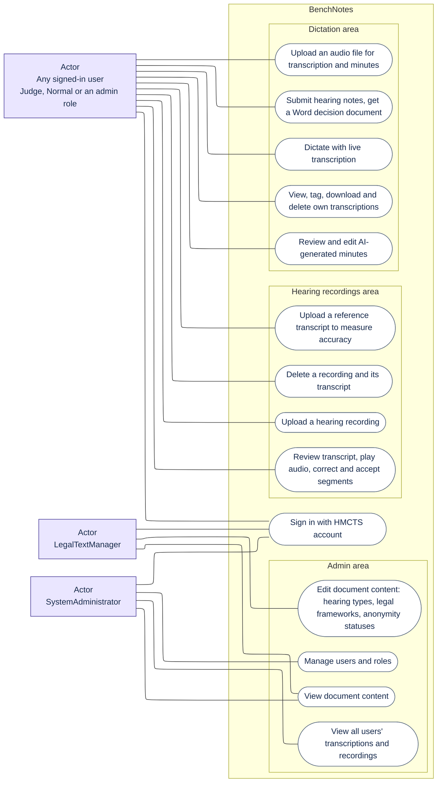
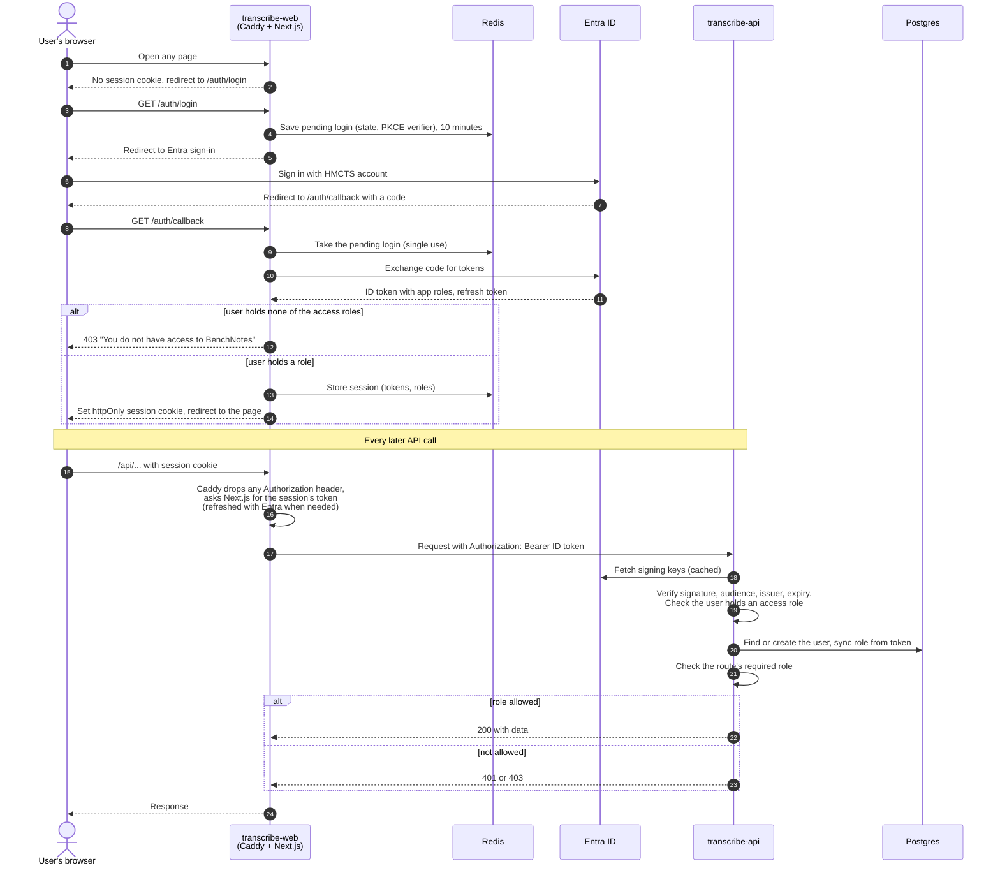
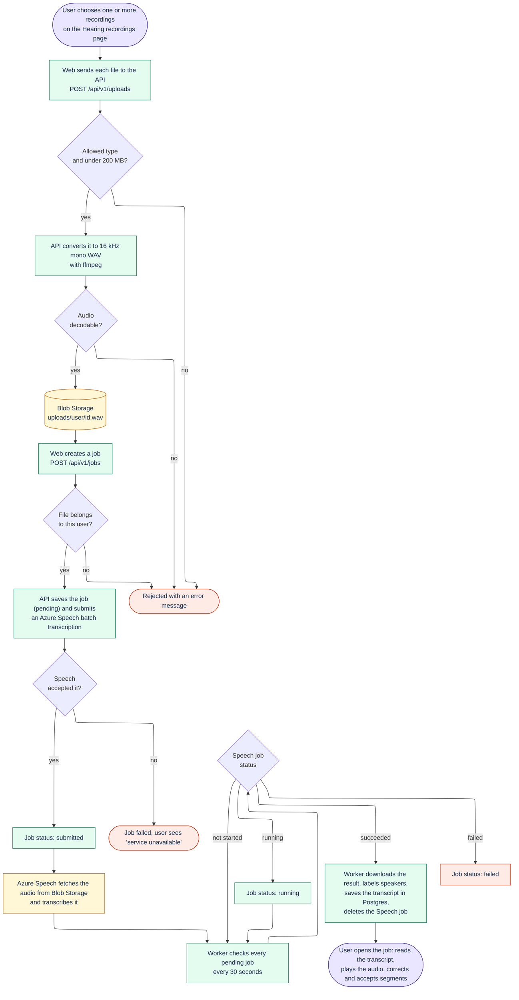
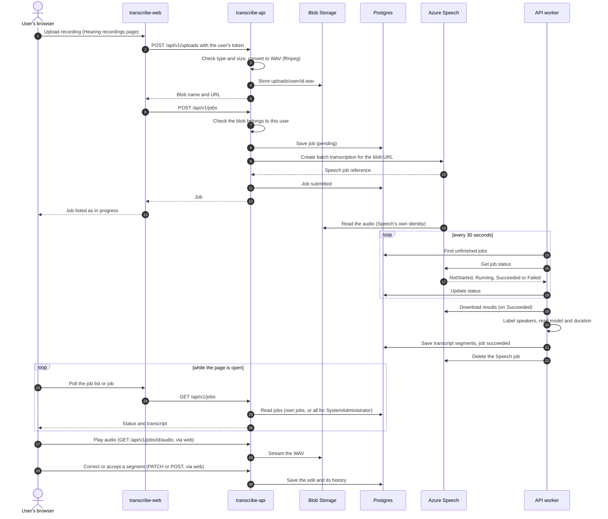
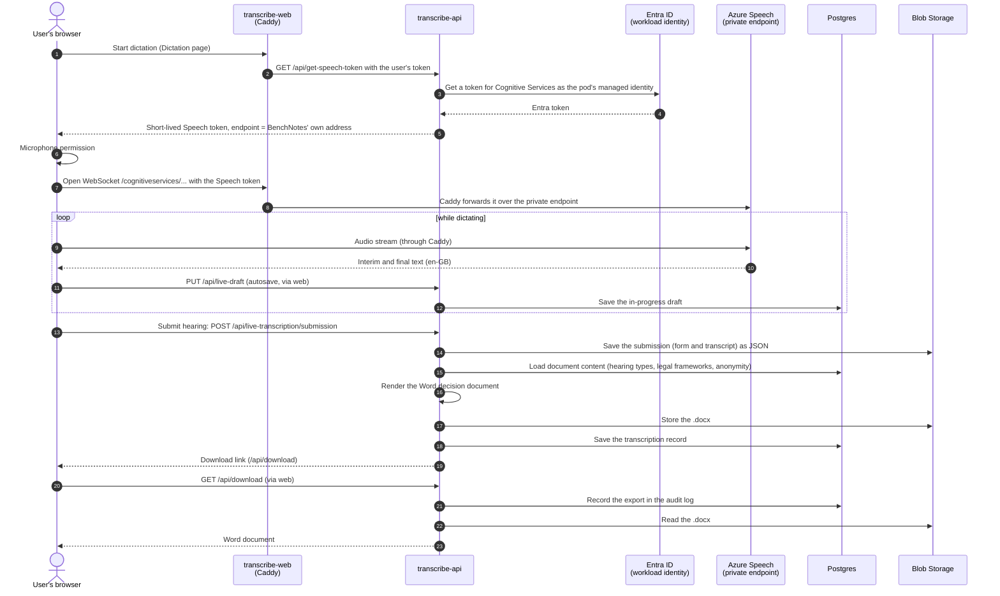
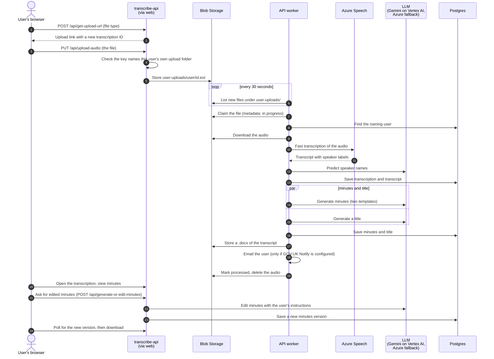
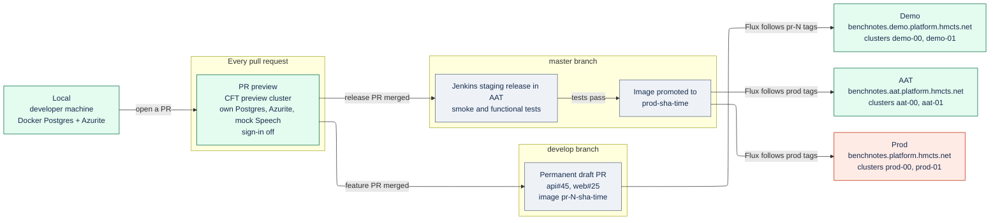
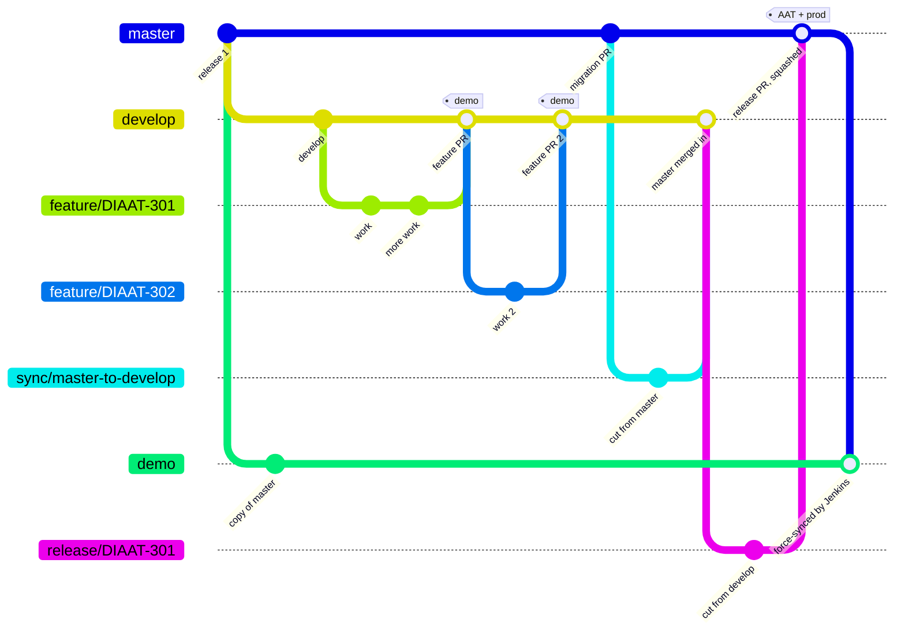
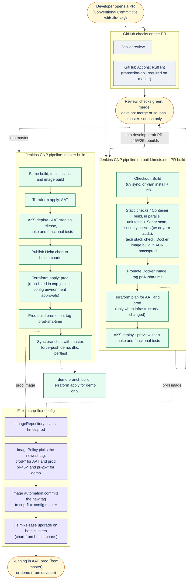

# Architecture and delivery diagrams

Mermaid sources for the BenchNotes architecture and delivery diagrams. The published version, with rendered images, is the Confluence page [BenchNotes architecture and delivery](https://hmcts.atlassian.net/wiki/spaces/AIE/pages/365888217/BenchNotes+architecture+and+delivery).

Each `.mmd` file is the source. The block under each heading below is a copy of it, so GitHub renders the diagram here; update both together.

| File | Diagram |
|---|---|
| [`01-architecture.mmd`](01-architecture.mmd) | [Architecture](#architecture): The deployed components on CFT AKS, the HMCTS edge in front of them, the Azure resources they use and the services outside Azure. |
| [`02-use-cases.mmd`](02-use-cases.mmd) | [Use cases](#use-cases): What each kind of user can do in the dictation, hearing recordings and admin areas. |
| [`03-seq-sign-in.mmd`](03-seq-sign-in.mmd) | [Sign-in and API calls](#sign-in-and-api-calls): How transcribe-web signs a user in with Entra ID and how transcribe-api checks the token and roles on every call. |
| [`04-flow-recording.mmd`](04-flow-recording.mmd) | [Hearing recording flow](#hearing-recording-flow): A hearing recording from upload, through conversion and Azure Speech batch transcription, to review, including the failure paths. |
| [`05-seq-recording.mmd`](05-seq-recording.mmd) | [Hearing recording sequence](#hearing-recording-sequence): The same journey as calls between the browser, web, API, worker, Blob Storage, Postgres and Azure Speech. |
| [`06-seq-dictation-live.mmd`](06-seq-dictation-live.mmd) | [Live dictation](#live-dictation): Live transcription through Caddy to Azure Speech, draft autosave, and the Word decision document on submission. |
| [`07-seq-dictation-upload.mmd`](07-seq-dictation-upload.mmd) | [Dictation audio upload](#dictation-audio-upload): An uploaded audio file transcribed by the worker, with speaker names, minutes and a title from the LLM. |
| [`08-environments.mmd`](08-environments.mmd) | [Environments](#environments): Local, PR preview, demo, AAT and prod, and how code and images move between them. |
| [`09-branching.mmd`](09-branching.mmd) | [Branching](#branching): The develop, master, release, sync and demo branches and how changes flow between them. |
| [`10-pipeline.mmd`](10-pipeline.mmd) | [Build and deploy pipeline](#build-and-deploy-pipeline): GitHub checks, the Jenkins CNP PR and master builds, and Flux image automation. |

## Updating a diagram

1. Edit the `.mmd` file and copy it into the matching block below.
2. Render a PNG:

   ```sh
   npx -y @mermaid-js/mermaid-cli@11 -i <file>.mmd -o <file>.png -b white -s 2
   ```

3. The Confluence page shows the diagrams as PNG attachments. Upload the new PNG over the old attachment of the same name so the page shows the change. The PNGs are not kept in this repo.

## Architecture

The deployed components on CFT AKS, the HMCTS edge in front of them, the Azure resources they use and the services outside Azure.

Source: [`01-architecture.mmd`](01-architecture.mmd)



## Use cases

What each kind of user can do in the dictation, hearing recordings and admin areas.

Source: [`02-use-cases.mmd`](02-use-cases.mmd)



## Sign-in and API calls

How transcribe-web signs a user in with Entra ID and how transcribe-api checks the token and roles on every call.

Source: [`03-seq-sign-in.mmd`](03-seq-sign-in.mmd)



## Hearing recording flow

A hearing recording from upload, through conversion and Azure Speech batch transcription, to review, including the failure paths.

Source: [`04-flow-recording.mmd`](04-flow-recording.mmd)



## Hearing recording sequence

The same journey as calls between the browser, web, API, worker, Blob Storage, Postgres and Azure Speech.

Source: [`05-seq-recording.mmd`](05-seq-recording.mmd)



## Live dictation

Live transcription through Caddy to Azure Speech, draft autosave, and the Word decision document on submission.

Source: [`06-seq-dictation-live.mmd`](06-seq-dictation-live.mmd)



## Dictation audio upload

An uploaded audio file transcribed by the worker, with speaker names, minutes and a title from the LLM.

Source: [`07-seq-dictation-upload.mmd`](07-seq-dictation-upload.mmd)



## Environments

Local, PR preview, demo, AAT and prod, and how code and images move between them.

Source: [`08-environments.mmd`](08-environments.mmd)



## Branching

The develop, master, release, sync and demo branches and how changes flow between them.

Source: [`09-branching.mmd`](09-branching.mmd)



## Build and deploy pipeline

GitHub checks, the Jenkins CNP PR and master builds, and Flux image automation.

Source: [`10-pipeline.mmd`](10-pipeline.mmd)


