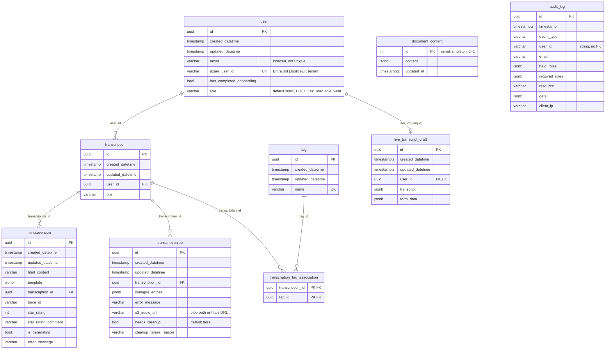
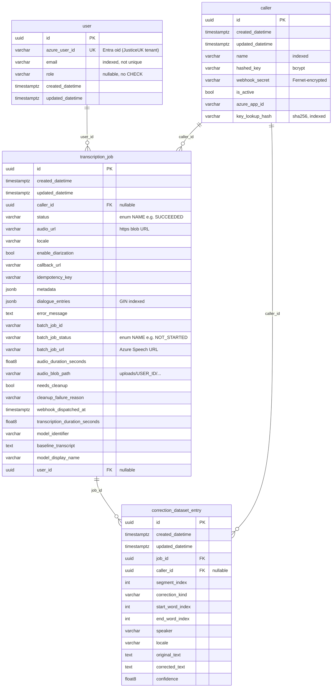
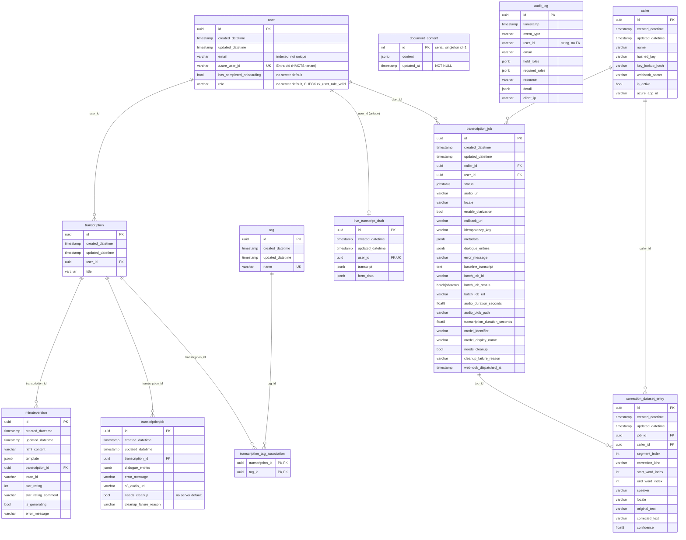

# Data migration reference: old schemas to the merged transcribe-api schema

## Purpose

transcribe-api merged two services, each with its own Postgres database:

- courtstranscribe, the "dictation" service. This is the main ETL source.
- batch-audio-transcription, the "recording" service. This is the secondary source.

This document records what those two old schemas look like and what the new merged schema looks like, and maps each old column to its new one. It is the input for designing an ETL that copies data from the old databases into a transcribe-api database. It does not describe an ETL implementation.

Every table, column, type, default and constraint below comes from introspecting (`pg_catalog` / `information_schema`) empty Postgres 16 databases built by running each Alembic history to head. Behaviour notes taken from application code, not from the schema, are labelled with the file they come from. Anything that could not be checked against real data is marked as uncertain.

## Sources

| Schema | Repo | Commit | Alembic history | Head revision |
|---|---|---|---|---|
| Old dictation | hmcts/courtstranscribe | `1ddfccaff99d3540930c6acc2d2800a80dfbd24f` (origin/main, 2026-10-14) | `backend/alembic/versions`, 14 revisions, base `de7d26bcb326` | `7f4d1e9c2b8a` |
| Old recording | hmcts/batch-audio-transcription | `c8de916d02a6e102b8931591349e77a8c2f63148` (origin/main, 2026-09-16) | `migrations/versions`, 13 revisions, base `001` | `013` |
| New merged | hmcts/transcribe-api | `43651b3` (schema unchanged at `0cdc47c`, which only touched `uv.lock`) | `alembic/versions`, 1 revision | `0001` |

Order of the courtstranscribe history: `de7d26bcb326` -> `d3ee506fc6d8` -> `ed7aa9a4e0f2` -> `34a9930bd1f7` -> (`a8f2c9d5e1b3` and `add_tags_table`, a branch) -> `5eb1a42de64d` (merge) -> `b4c7e1f2a8d9` -> `500e1b42c7d9` -> `a1b2c3d4e5f6` -> `c2d4f6a8b0e1` -> `3c8a2f94b6d1` -> `8e2a5d9f3b7c` -> `7f4d1e9c2b8a`.

The batch-audio-transcription history runs in order from `001` to `013`.

Update: revision `0002` fixes the two regressions this document describes against `0001`. It restores `timestamp with time zone` on every column that had it in the old schemas, and adds back the three dictation foreign-key indexes. With the target at `0002`, copy the old `timestamptz` columns as they are, with no `AT TIME ZONE 'UTC'`. The rest of this document still describes `0001`.

Update: revision `0003` adds the DIAAT-205 observability columns. See [DIAAT-205 additions (`0003`)](#diaat-205-additions-0003).

## Summary of differences

- Table names. The two old schemas share only one table name, `user`. The new schema is the union of both: 12 tables. `transcriptionjob` (dictation) and `transcription_job` (recording) are separate tables with different columns, and both still exist.
- User. The merged `user` is the dictation one, which has `has_completed_onboarding` and a NOT NULL `role` with CHECK `ck_user_role_valid`. Recording's `user` had a nullable, unconstrained `role` and no `has_completed_onboarding`.
- Timezones. Every `timestamp with time zone` column in the old schemas is `timestamp without time zone` in the new one. That covers all recording tables, plus dictation's `audit_log`, `live_transcript_draft` and `document_content`.
- Enums. In the old recording schema, `transcription_job.status` and `batch_job_status` were `varchar`. In the new schema they are the native Postgres enums `jobstatus` and `batchjobstatus`.
- Dropped server defaults:
  - dictation `user.role` (`'user'`)
  - dictation `transcriptionjob.needs_cleanup` (`false`)
- `document_content.updated_at` changed from nullable to NOT NULL.
- Some `text` columns are now unbounded `varchar`. This changes nothing for the data.
- Missing indexes. Dictation migration `a8f2c9d5e1b3` added three foreign-key indexes that the new baseline does not have: `ix_transcription_user_id`, `ix_minuteversion_transcription_id` and `ix_transcriptionjob_transcription_id`. They do not affect correctness, but a bulk load and the queries that index was added for (see that migration's docstring) will run without them.
- Seeds. The new baseline seeds no rows. The old dictation migrations inserted `document_content` id=1, and the old recording migrations 004 and 013 upserted a `frontend-service` caller when `FRONTEND_SERVICE_API_KEY` was set.

## Old courtstranscribe (dictation) schema



`audit_log` and `document_content` have no foreign keys.

### Table reference (dictation, at `7f4d1e9c2b8a`)

`timestamp` means `timestamp without time zone`, `timestamptz` means `timestamp with time zone`, and `varchar` has no length limit unless one is shown.

| Table | Column | Type | Null | Default |
|---|---|---|---|---|
| user | id | uuid | no | |
| | created_datetime | timestamp | no | |
| | updated_datetime | timestamp | yes | |
| | email | varchar | no | |
| | azure_user_id | varchar | no | |
| | has_completed_onboarding | boolean | no | |
| | role | varchar | no | `'user'` |
| transcription | id, created_datetime, updated_datetime | uuid, timestamp, timestamp | no, no, yes | |
| | user_id | uuid | no | |
| | title | varchar | yes | |
| minuteversion | id, created_datetime, updated_datetime | uuid, timestamp, timestamp | no, no, yes | |
| | html_content | varchar | no | |
| | template | jsonb | yes | |
| | transcription_id | uuid | no | |
| | trace_id, star_rating_comment, error_message | varchar | yes | |
| | star_rating | integer | yes | |
| | is_generating | boolean | yes | |
| transcriptionjob | id, created_datetime, updated_datetime | uuid, timestamp, timestamp | no, no, yes | |
| | transcription_id | uuid | no | |
| | dialogue_entries | jsonb | yes | |
| | error_message, s3_audio_url, cleanup_failure_reason | varchar | yes | |
| | needs_cleanup | boolean | no | `false` |
| tag | id, created_datetime, updated_datetime | uuid, timestamp, timestamp | no, no, yes | |
| | name | varchar | no | |
| transcription_tag_association | transcription_id, tag_id | uuid | no | |
| live_transcript_draft | id | uuid | no | |
| | created_datetime | timestamptz | no | |
| | updated_datetime | timestamptz | yes | |
| | user_id | uuid | no | |
| | transcript, form_data | jsonb | no | |
| document_content | id | integer | no | `nextval('document_content_id_seq')` |
| | content | jsonb | no | |
| | updated_at | timestamptz | yes | |
| audit_log | id | uuid | no | |
| | timestamp | timestamptz | no | |
| | event_type, user_id, email | varchar | no | |
| | held_roles, required_roles | jsonb | no | |
| | resource, client_ip | varchar | yes | |
| | detail | jsonb | yes | |

Constraints and indexes (dictation):

| Table | Constraints | Indexes, other than the PK |
|---|---|---|
| user | PK `user_pkey (id)`; CHECK `ck_user_role_valid`: `role IN ('Normal','Judge','LegalTextManager','SystemAdministrator')` | `ix_user_azure_user_id` UNIQUE (azure_user_id); `ix_user_email` (email); `ix_user_role` (role) |
| transcription | FK `transcription_user_id_fkey` (user_id) -> user.id | `ix_transcription_user_id` (user_id) |
| minuteversion | FK `minuteversion_transcription_id_fkey` -> transcription.id | `ix_minuteversion_transcription_id` |
| transcriptionjob | FK `transcriptionjob_transcription_id_fkey` -> transcription.id | `ix_transcriptionjob_transcription_id` |
| tag | | `ix_tag_name` UNIQUE (name) |
| transcription_tag_association | PK (transcription_id, tag_id); FKs to transcription.id and tag.id | |
| live_transcript_draft | FK `live_transcript_draft_user_id_fkey` -> user.id; UNIQUE `live_transcript_draft_user_id_key (user_id)` | |
| document_content | | |
| audit_log | | `ix_audit_log_event_type`, `ix_audit_log_timestamp`, `ix_audit_log_user_id` |

There are no enum types. After the history runs to head, `document_content` contains one row, id=1, seeded by migrations `500e1b42c7d9` and `a1b2c3d4e5f6` from `backend/data/document_content.json`.

Introspection found one oddity: `user.role` still has the server default `'user'`. That default comes from `b4c7e1f2a8d9`, and it fails the CHECK that `8e2a5d9f3b7c` added later. Inserting a user without a role into the old database fails with a CheckViolation (tested). The old application always set role explicitly, so existing rows should only hold the four valid values. The CHECK guarantees that for rows written after `8e2a5d9f3b7c`, and that migration rewrote earlier `'user'` rows to `'Normal'`.

## Old batch-audio-transcription (recording) schema



### Table reference (recording, at `013`)

No column in this schema has a server default. The `default=` values in migration 001 are client-side only.

| Table | Column | Type | Null |
|---|---|---|---|
| user | id | uuid | no |
| | azure_user_id, email | varchar | no |
| | role | varchar | yes |
| | created_datetime | timestamptz | no |
| | updated_datetime | timestamptz | yes |
| caller | id | uuid | no |
| | created_datetime | timestamptz | no |
| | updated_datetime | timestamptz | yes |
| | name, hashed_key, webhook_secret | varchar | no |
| | is_active | boolean | no |
| | azure_app_id, key_lookup_hash | varchar | yes |
| transcription_job | id | uuid | no |
| | created_datetime | timestamptz | no |
| | updated_datetime, webhook_dispatched_at | timestamptz | yes |
| | caller_id, user_id | uuid | yes |
| | status, audio_url, locale | varchar | no |
| | enable_diarization, needs_cleanup | boolean | no |
| | callback_url, idempotency_key, batch_job_id, batch_job_status, batch_job_url, audio_blob_path, cleanup_failure_reason, model_identifier, model_display_name | varchar | yes |
| | metadata, dialogue_entries | jsonb | yes |
| | error_message, baseline_transcript | text | yes |
| | audio_duration_seconds, transcription_duration_seconds | double precision | yes |
| correction_dataset_entry | id, job_id | uuid | no |
| | caller_id | uuid | yes |
| | created_datetime | timestamptz | no |
| | updated_datetime | timestamptz | yes |
| | segment_index | integer | no |
| | start_word_index, end_word_index | integer | yes |
| | correction_kind, speaker, locale | varchar | no |
| | original_text, corrected_text | text | no |
| | confidence | double precision | yes |

Constraints and indexes (recording):

| Table | Constraints | Indexes, other than the PK |
|---|---|---|
| user | | `ix_user_azure_user_id` UNIQUE; `ix_user_email` |
| caller | | `ix_caller_name`; `ix_caller_key_lookup_hash` |
| transcription_job | FK `transcription_job_caller_id_fkey` -> caller.id; FK `fk_transcription_job_user_id_user` -> user.id; UNIQUE `uq_transcription_job_caller_idempotency (caller_id, idempotency_key)` | `ix_transcription_job_caller_id`; `ix_transcription_job_user_id`; `ix_transcription_job_dialogue_entries_gin` GIN (dialogue_entries); `ix_transcription_job_user_idempotency` UNIQUE (user_id, idempotency_key) WHERE user_id IS NOT NULL AND idempotency_key IS NOT NULL |
| correction_dataset_entry | FK job_id -> transcription_job.id; FK caller_id -> caller.id | `ix_correction_dataset_entry_job_id`; `ix_correction_dataset_entry_caller_id` |

There are no enum types. `status` and `batch_job_status` are varchar columns, but the old model typed them as `StrEnum`s, and SQLAlchemy writes the enum member NAME, not its value. To check this, the same model class (now `SpeechBatchJob` in transcribe-api, identical to the old `TranscriptionJob`) wrote a row into the old varchar column. The row stored `status='SUCCEEDED'` and `batch_job_status='NOT_STARTED'`, not `'succeeded'` or `'NotStarted'`.

With `FRONTEND_SERVICE_API_KEY` unset, the history to head leaves every table empty. In deployed environments it was set, so 004 and 013 created and updated a `caller` row named `frontend-service`.

## New transcribe-api schema (`0001`)



`user` is the only table that both halves of the schema reference. The dictation tables and the recording tables are otherwise unconnected.

### Table reference (new, at `0001`)

All timestamp columns are `timestamp without time zone`. The only server default in the whole schema is the `document_content.id` sequence.

| Table | Column differences from its old source table |
|---|---|
| user | Same as dictation `user`, except `role` has no server default. Both `role` and `has_completed_onboarding` are NOT NULL with no default. |
| transcription, minuteversion, tag, transcription_tag_association | Same columns as dictation. |
| transcriptionjob | Same columns as dictation, except `needs_cleanup` has no server default. |
| live_transcript_draft | Same as dictation, but `created_datetime` and `updated_datetime` are `timestamp`. |
| document_content | Same as dictation, but `updated_at` is `timestamp` NOT NULL. |
| audit_log | Same as dictation, but `timestamp` is `timestamp`. |
| caller | Same columns as recording, in a different order, and timestamps are `timestamp`. |
| transcription_job | Same columns as recording, in a different order. `status` is `jobstatus` NOT NULL, `batch_job_status` is `batchjobstatus` NULL, `error_message` is `varchar`, and timestamps are `timestamp`. |
| correction_dataset_entry | Same as recording. `original_text` and `corrected_text` are `varchar`, and timestamps are `timestamp`. |

Enums:

| Enum | Labels |
|---|---|
| `jobstatus` | `PENDING`, `SUBMITTED`, `RUNNING`, `SUCCEEDED`, `FAILED` |
| `batchjobstatus` | `NOT_STARTED`, `RUNNING`, `SUCCEEDED`, `FAILED` |

Constraints and indexes (new):

| Table | Constraints | Indexes, other than the PK |
|---|---|---|
| user | CHECK `ck_user_role_valid`, the same as dictation | `ix_user_azure_user_id` UNIQUE; `ix_user_email`; `ix_user_role` |
| transcription | FK user_id -> user.id | none (dictation had `ix_transcription_user_id`) |
| minuteversion | FK transcription_id -> transcription.id | none (dictation had `ix_minuteversion_transcription_id`) |
| transcriptionjob | FK transcription_id -> transcription.id | none (dictation had `ix_transcriptionjob_transcription_id`) |
| tag | | `ix_tag_name` UNIQUE |
| transcription_tag_association | PK (transcription_id, tag_id), FKs | |
| live_transcript_draft | FK user_id -> user.id; UNIQUE (user_id) | |
| audit_log | | `ix_audit_log_event_type`, `ix_audit_log_timestamp`, `ix_audit_log_user_id` |
| caller | | `ix_caller_name`, `ix_caller_key_lookup_hash` |
| transcription_job | FK caller_id -> caller.id; FK `transcription_job_user_id_fkey` (renamed from `fk_transcription_job_user_id_user`) -> user.id; UNIQUE `uq_transcription_job_caller_idempotency` | `ix_transcription_job_caller_id`, `ix_transcription_job_user_id`, `ix_transcription_job_dialogue_entries_gin` GIN, `ix_transcription_job_user_idempotency` UNIQUE partial, with the same predicate as recording |
| correction_dataset_entry | FKs job_id -> transcription_job.id, caller_id -> caller.id | `ix_correction_dataset_entry_job_id`, `ix_correction_dataset_entry_caller_id` |

## Mapping: courtstranscribe -> transcribe-api

All dictation tables keep their names. Unless a row says otherwise, copy each column as is.

| Old table.column | New table.column | Transform / notes |
|---|---|---|
| user.* | user.* | See [Merged `user`](#merged-user). `azure_user_id` must be re-keyed. |
| transcription.id | transcription.id | Keep the UUID. |
| transcription.created_datetime, updated_datetime | same | Both are `timestamp`, so no change. |
| transcription.user_id | transcription.user_id | Remap through the user mapping if dictation users are merged or de-duplicated. If no duplicates are merged, it stays the same. |
| transcription.title | transcription.title | |
| minuteversion.* (11 columns) | minuteversion.* | Identical. `template` is jsonb that matches the `TemplateMetadata` shape. |
| transcriptionjob.id, created_datetime, updated_datetime, transcription_id, dialogue_entries, error_message, cleanup_failure_reason | same | Identical. |
| transcriptionjob.needs_cleanup | transcriptionjob.needs_cleanup | Copy explicitly. The new column has no server default, so omitting it fails NOT NULL. |
| transcriptionjob.s3_audio_url | transcriptionjob.s3_audio_url | Blob reference. Despite the name, it holds a blob path (`user-uploads/{segment}/...`) or a full `https://{account}.blob.core.windows.net/{container}/...` URL. For live-transcription submissions it points at a `.docx` hearing document, not audio. The `{segment}` is the user's old oid or, on older rows, their email. See [Blob references](#blob-references). |
| tag.*, transcription_tag_association.* | same | Identical. `tag.name` is unique in both schemas. |
| live_transcript_draft.id, transcript, form_data | same | |
| live_transcript_draft.user_id | same | Remap through the user mapping. UNIQUE(user_id) means only one draft per user. If two old users merge into one, keep one draft. |
| live_transcript_draft.created_datetime, updated_datetime | same | timestamptz -> timestamp. Convert with `AT TIME ZONE 'UTC'`. |
| document_content.id, content | same | Singleton id=1. See [Seeds](#seeds). |
| document_content.updated_at | document_content.updated_at | timestamptz NULL -> timestamp NOT NULL: `COALESCE(updated_at, now()) AT TIME ZONE 'UTC'`. |
| audit_log.id, event_type, email, held_roles, required_roles, resource, detail, client_ip | same | Identical. |
| audit_log.timestamp | audit_log.timestamp | timestamptz -> timestamp, `AT TIME ZONE 'UTC'`. |
| audit_log.user_id | audit_log.user_id | A free-text identity string with no FK, written by `hmcts_azure_auth` (appears to be the caller's Entra oid). Historical rows keep the old JusticeUK oid. Leave them as is unless a lookup back to `user` is needed. |
| alembic_version | (not copied) | The target is created by its own migrations. See below. |

## Mapping: batch-audio-transcription -> transcribe-api

| Old table.column | New table.column | Transform / notes |
|---|---|---|
| user.* | user.* | See [Merged `user`](#merged-user). |
| caller.id, name, hashed_key, key_lookup_hash, is_active, azure_app_id | caller.* | Same columns. Copy every caller that a `transcription_job` or `correction_dataset_entry` row references, otherwise the FK fails. Whether to copy unreferenced callers, and whether to keep `frontend-service` active, is a decision. The new app no longer uses `frontend-service` (see the baseline docstring). Setting `is_active=false` keeps referenced history while disabling the key. |
| caller.webhook_secret | caller.webhook_secret | Encrypted with the old environment's Fernet `WEBHOOK_SECRET_ENCRYPTION_KEY`. It decrypts only if the new environment uses the same key. Otherwise it must be re-encrypted. `hashed_key` is a bcrypt hash of the raw API key, so a key keeps working only if API-key auth is still enabled. Not verified for the new app. |
| caller.created_datetime, updated_datetime | same | timestamptz -> timestamp, `AT TIME ZONE 'UTC'`. |
| transcription_job.id | transcription_job.id | Keep the UUID. `correction_dataset_entry.job_id` references it. |
| transcription_job.created_datetime, updated_datetime, webhook_dispatched_at | same | timestamptz -> timestamp, `AT TIME ZONE 'UTC'`. |
| transcription_job.caller_id | same | Keep it, as long as the caller row is copied. Remember UNIQUE (caller_id, idempotency_key). |
| transcription_job.user_id | same | Remap through the user mapping. A recording user merged into an existing dictation user takes that user's `id`. |
| transcription_job.status | transcription_job.status | varchar -> `jobstatus`: `status::jobstatus`. The model wrote enum NAMES (`PENDING` ... `FAILED`), which are exactly the new labels. Any lowercase or other value, for example from a manual SQL fix, fails the cast. Run `SELECT DISTINCT status` first. |
| transcription_job.batch_job_status | transcription_job.batch_job_status | varchar NULL -> `batchjobstatus` NULL: `batch_job_status::batchjobstatus`. Old rows should hold `NOT_STARTED`/`RUNNING`/`SUCCEEDED`/`FAILED`. Azure's own strings (`NotStarted`, `Succeeded`) do not cast. Check `SELECT DISTINCT` first. |
| transcription_job.audio_url | same | Blob reference. A full, SAS-free `https://{account}.blob.core.windows.net/{container}/uploads/...` URL, built by `build_blob_url` in `transcription_svc/audio/azure_utils.py`. Rewrite it if the storage account or container changes. |
| transcription_job.audio_blob_path | same | Blob reference: `uploads/{old recording user.id}/{uuid}-{name}.wav`. `GET /jobs/{id}/audio` reads this path from storage. The path segment is the old recording `user.id`, not an oid. It no longer matches the owner's id if that user is merged into a dictation user with a different id. In the new code, `routes_recording.py` checks ownership against this prefix only when a job is created, so existing rows still read. |
| transcription_job.batch_job_url, batch_job_id | same | Azure Speech batch transcription URL and id in the old Speech resource. They are only usable while that resource exists. Terminal jobs do not need them. |
| transcription_job.callback_url | same | External caller webhook URL. Copy as is. |
| transcription_job.error_message | same | text -> varchar with no length limit, so nothing is truncated. |
| transcription_job.locale, enable_diarization, idempotency_key, metadata, dialogue_entries, audio_duration_seconds, needs_cleanup, cleanup_failure_reason, transcription_duration_seconds, model_identifier, baseline_transcript, model_display_name | same | Identical types. Copy `needs_cleanup` explicitly. No server default. |
| correction_dataset_entry.* | correction_dataset_entry.* | Same columns. Timestamps timestamptz -> timestamp. `original_text` and `corrected_text` go from text to unbounded varchar. This table may hold real hearing content under an unresolved compliance note (see the model docstring). Check whether to migrate it at all. |
| alembic_version | (not copied) | |

## Merged `user`

The new `user` is the dictation table. Recording users and dictation users load into the same table.

| New column | From dictation `user` | From recording `user` | Notes |
|---|---|---|---|
| id | `id` | `id` | Keep one UUID per person. If a person exists in both sources, keep the dictation `id` (the dictation tables reference it from `transcription` and `live_transcript_draft`) and remap recording `transcription_job.user_id` to it. If a person exists only in recording, keep the recording `id`. Check that no UUID appears in both sources for two different people. Unlikely, but cheap to check. |
| created_datetime | as is (timestamp) | `created_datetime AT TIME ZONE 'UTC'` | For a merged person, take the earlier value. |
| updated_datetime | as is | `AT TIME ZONE 'UTC'` | |
| email | as is | as is | Not unique in any schema. The new work poller (`stt/work_poller.py`) finds users with `WHERE email = ...` and takes the first row, so de-duplicate by email. |
| azure_user_id | REWRITE | REWRITE | Unique and NOT NULL. Must hold the person's oid in the HMCTS tenant. See [User re-keying](#user-re-keying-oid-change). |
| has_completed_onboarding | as is | none: supply it (NOT NULL, no default) | For recording-only users the choice is `false`, the model default, or `true`. This is a product decision. For a merged person use the dictation value. |
| role | as is (CHECK already enforced) | `role`, which may be NULL or any string | Must satisfy `ck_user_role_valid` (`Normal`, `Judge`, `LegalTextManager`, `SystemAdministrator`). Map NULL to `'Normal'`, the merged model default. Recording had no CHECK, and the old code stored whatever `AUTH_APPROLES` mapped the role to (by default the same four names). Run `SELECT DISTINCT role` and map anything else. On every sign-in both old and new code overwrite `role` from the token's app roles, so the migrated value only matters until the user's first sign-in. |

## DIAAT-205 additions (`0003`)

Revision `0003` adds the observability columns from the DIAAT-205 branches of both old services. Every new column is nullable with no default.

| Table | Column | Type | From | Meaning |
|---|---|---|---|---|
| audit_log | outcome | varchar(16) | dictation `9d1e6b3a4c2f` | `success`, `denied` or `failed`. NULL on rows written before `0003` |
| audit_log | object_type | varchar(32) | dictation `9d1e6b3a4c2f` | What the action was on (`transcription`, `transcript`, `job`, `upload`...) |
| audit_log | object_id | varchar(64), indexed | dictation `9d1e6b3a4c2f` | A record UUID as text, never a title or file name |
| audit_log | request_id | varchar(64), indexed | dictation `9d1e6b3a4c2f` | `hmcts.request.id`: joins the row to the request's telemetry |
| audit_log | email | now nullable | dictation `9d1e6b3a4c2f` | Only the auth library's rows have it. App rows identify the actor by `user_id` |
| transcription_job | trace_parent | varchar(64) | recording `014` | W3C traceparent of the request that created the job |
| transcription_job | processing_started_datetime | timestamptz | recording `015` | When Azure Speech started processing the job |
| transcription_job | stuck_reported_at | timestamptz | recording `015` | When the job was reported as stuck (once per job) |
| transcription_job | provenance | jsonb | recording `017` | The configuration that produced the transcript. No content |
| transcriptionjob | provenance | jsonb | dictation `9d1e6b3a4c2f` | The configuration that produced the job's output. No content |

The recording service's own `audit_log` table (recording `016`) is not created: the recording service writes the shared `audit_log`.

`audit_log.user_id` holds two kinds of identity. Rows written by the app hold the internal user UUID (`user.id`). That covers `USER_DELETED`/`user.delete` and `ROLE_CHANGE` on the old `main`, and every DIAAT-286 row. Rows written by `hmcts_azure_auth` itself, such as `ACCESS_DENIED` on a failed role check, hold the caller's Entra oid.

### Action names

App-written actions become `<object>.<verb>`. `ACCESS_DENIED` and `ROLE_CHANGE` are written by `hmcts_azure_auth` and do not change.

| Old `event_type` | New `event_type` | In old production? |
|---|---|---|
| `USER_DELETED` | `user.delete` | Yes: written by the old `main` since DIAAT-20 (`81e6bc7`, released v0.2.14) when an admin deletes a user |
| `TRANSCRIPT_VIEWED` | `transcript.view` | No: only on the DIAAT-286 branch |
| `TRANSCRIPT_EXPORTED` | `transcript.export` | No: only on the DIAAT-286 branch |
| `TRANSCRIPT_DELETED` | `transcript.delete` | No: only on the DIAAT-286 branch |

The ETL maps `USER_DELETED` to `user.delete` unconditionally. That costs less than checking first whether any rows exist.

### If the old DIAAT-205 branches reach production before cut-over

Neither old `main` has these columns: the sources above are at `7f4d1e9c2b8a` and `013`. If either DIAAT-205 branch is released first, copy its columns as follows.

| Old table.column | New table.column | Transform / notes |
|---|---|---|
| dictation audit_log.outcome, object_type, object_id, request_id | same | Copy. Map `event_type` as in the table above |
| dictation transcriptionjob.provenance | transcriptionjob.provenance | Copy |
| recording transcription_job.trace_parent, processing_started_datetime, stuck_reported_at, provenance | same | Copy |
| recording audit_log.id, timestamp | audit_log.id, timestamp | Copy. Recording ids are UUIDs and do not collide with dictation ids |
| recording audit_log.actor_id | audit_log.user_id | uuid -> text. Remap through the user mapping, like `transcription_job.user_id` |
| recording audit_log.action | audit_log.event_type | Same values (`job.submit`, `transcript.view`, `transcript.edit`, `audio.export`, `job.delete`) |
| recording audit_log.outcome, object_type, request_id, detail | same | Copy |
| recording audit_log.object_id | audit_log.object_id | uuid -> text |
| (none) | audit_log.held_roles, required_roles | `'[]'`. NOT NULL |
| (none) | audit_log.email, resource, client_ip | NULL |

## ETL considerations

### Load order and keys

The FKs require parents to load before children:

1. `user`, after re-keying and de-duplication. Also `caller`, `tag` and `document_content`, which have no parents.
2. `transcription`, `live_transcript_draft` and `transcription_job`.
3. `minuteversion`, `transcriptionjob`, `transcription_tag_association` and `correction_dataset_entry`.
4. `audit_log`, which has no FK and can load at any point.

Keep every UUID primary key. Every FK in both schemas is a UUID that points at a UUID PK, so copying keys avoids building id maps everywhere except `user`. The new schema has no server-side UUID defaults. The application generates ids, so the ETL must always supply `id`. Table names do not overlap between the two sources except `user`, so `transcription_job` ids cannot collide with `transcriptionjob` ids.

`document_content.id` is a serial. Copying id=1 explicitly leaves `document_content_id_seq` at 1. That is harmless, because the app only ever uses id=1. Running `setval` afterwards keeps it tidy.

### User re-keying (oid change)

`user.azure_user_id` stores the Entra object ID (oid) of the signed-in user. The old services signed users in through the MoJ JusticeUK tenant app registration. transcribe-api uses an HMCTS-tenant registration, where users are HMCTS members or B2B guests. An oid is specific to one tenant, so the same person has a different oid in the new app.

Both new auth paths (`domain/auth/dependencies_dictation.py` and `dependencies_recording.py`) look users up only with `WHERE azure_user_id = <token oid>`. When there is no match they INSERT a new user. If the ETL copies old oids unchanged, every migrated user appears as a new, empty user on first sign-in, and their old transcriptions are orphaned under the old row.

The ETL therefore has to build an old-to-new user mapping. Two approaches:

- Re-key before loading. For each old user, find their HMCTS-tenant object (member or guest) and write its oid into `azure_user_id`. The likely join key is email. Uncertain: whether a B2B guest's `email` claim and Graph `mail` match the address stored in the old tables (JusticeUK UPN or mail) is not verified. Some users may need an explicit mapping list.
- Re-key on first sign-in. Load the users and change the app to fall back to an email match when the oid is unknown, then update `azure_user_id`. That needs a code change, which the current code does not have, and a decision on how much to trust the email claim.

Within one source, `email` is not unique. Duplicate rows for the same person, for example after an earlier oid change, must be merged, and their child rows remapped. Across the two sources, if both old services used the same JusticeUK tenant, the same person has the same old oid in both databases. That makes old `azure_user_id` the most reliable join between dictation and recording users, with lowercased, trimmed email as a fallback. Whether both old services shared one tenant is not verified here.

`audit_log.user_id` and `audit_log.email` are historical strings and are not re-keyed.

### Blob references

Blob storage moves along with the database. These columns hold references to it:

| Column | Holds | What can break |
|---|---|---|
| `transcriptionjob.s3_audio_url` (dictation) | `user-uploads/{oid or email}/{file}` or a full `https://{account}.blob.core.windows.net/{container}/...` URL. It can point at audio or at a generated `.docx`. | The account and container in full URLs. The path's ownership segment: new `routes_dictation._validate_blob_ownership` allows access only if `parts[1]` equals the user's current `azure_user_id`, or equals their email case-insensitively. OID-based paths (`user-uploads/{old oid}/...`) fail after re-keying unless blobs are renamed to the new oid and the column is rewritten. Email-based paths keep working only if the email is unchanged. |
| `transcription_job.audio_url` (recording) | Full SAS-free https blob URL | Storage account and container. |
| `transcription_job.audio_blob_path` (recording) | `uploads/{recording user.id}/...` | Container. The segment is the old recording `user.id`, which changes for merged users (see above). |
| `transcription_job.batch_job_url` (recording) | Azure Speech transcription URL | Old Speech resource. |
| `live_transcript_draft.transcript`, `form_data`, `minuteversion.template`, `dialogue_entries` | jsonb | Not inspected for blob paths. Uncertain whether any contain them. |

#### Old-oid blob paths after user re-keying

courtstranscribe has written dictation blobs under `user-uploads/{azure_user_id}/...` since commit `81e6bc7` (2026-07-20, DIAAT-20). Older blobs are under `user-uploads/{email}/...`. Once the ETL re-keys `user.azure_user_id` to the HMCTS-tenant oid, an oid-keyed path matches neither the user's new oid nor their email. In transcribe-api (`api/routes_dictation.py`):

- `GET /download` and `GET /transcriptions/{id}/jobs/{job_id}/audio` read the path from `transcriptionjob.s3_audio_url`, then call `_validate_blob_ownership`, which compares the path's second segment with the current `azure_user_id` or email. For these blobs it returns 403.
- `GET /transcriptions/{id}/sectioned-transcript` lists blobs under `user-uploads/{current oid}/` and `user-uploads/{current email}/`, so it does not find them.

Options:

- (a) Rename the blobs to the new oid and rewrite `transcriptionjob.s3_audio_url` to match.
- (b) For paths read from the database, rely on the ownership check those routes already make (`get_transcription_by_id(transcription_id, current_user.id, ...)`) instead of the path segment. This avoids renaming blobs. `sectioned-transcript` lists by prefix rather than reading a stored path, so it would still need (a) or another lookup.

#### Audio copied without blob metadata is deleted

Every time the dictation work poller starts (`stt/work_poller.py`, `_cleanup_old_blobs_on_startup` and `_should_delete_old_blob`), it deletes every blob under `user-uploads/` that has an audio extension (`.mp4`, `.webm`, `.wav`, `.m4a`, `.mp3`, `.ogg`, `.aac`, `.mov`) and no `processed`, `status` or `retry_count` metadata ("legacy blob without metadata"). The startup cleanup is not limited by age. An ETL copy of audio blobs must therefore keep their blob metadata. The same cleanup also deletes audio marked `processed=true`, by design, so only unprocessed or retrying audio survives even with metadata kept. `.docx` and `.json` blobs are not affected.

### Enums, roles and constraints the data could violate

- `transcription_job.status` and `batch_job_status`: cast the varchar to the enum. Valid only for the upper-case names. Check first with `SELECT DISTINCT`.
- `user.role`: CHECK `ck_user_role_valid`. Recording NULLs and any non-standard values must be mapped. The old dictation value `'user'` was already normalised by `8e2a5d9f3b7c`.
- NOT NULL columns with no server default in the new schema: `user.role`, `user.has_completed_onboarding`, `transcriptionjob.needs_cleanup`, `transcription_job.needs_cleanup`, `document_content.updated_at`, and every `created_datetime` and `id`. The ETL must supply all of them.
- `live_transcript_draft` UNIQUE(user_id): conflicts happen only when users are merged.
- `transcription_job` UNIQUE (caller_id, idempotency_key) and the partial UNIQUE (user_id, idempotency_key): these already held in the source. A user merge could create duplicates under the partial index only if one person had jobs under two recording users with the same idempotency key. Check before loading.

### Timestamps and timezones

The new schema has only `timestamp without time zone`. The app writes `datetime.now(UTC)` (tz-aware) through psycopg2, which sends it as a `timestamptz` that Postgres then casts with the session `TimeZone`. Tested: in a session set to `Europe/London`, an aware 12:00Z value is stored as 13:00 in a `timestamp` column. In a UTC session it is stored as 12:00. So naive columns hold UTC wall-clock time only when the server or session timezone is UTC.

- For old `timestamptz` columns, use `col AT TIME ZONE 'UTC'`, not a plain `::timestamp` cast. A plain cast uses the session timezone. Tested: under `Europe/London` it shifts BST values by an hour.
- For old dictation `timestamp` columns, copy as is. Uncertain: this assumes the old dictation server's TimeZone was UTC, which is the default for Azure Database for PostgreSQL. It was not checked on the deployed server.

### Seeds

- `document_content` id=1: the new baseline does not seed it. On first read (`documents/content_loader.py`) the app inserts the bundled `src/transcribe_api/data/document_content.json`, which is byte-identical to `courtstranscribe backend/data/document_content.json`. Admin users can edit this row (`routes_dictation_privileged._write_content`), so the old production row may differ from the bundled file. Load it in the ETL, as an upsert on id=1, preferably before the new app serves traffic. Otherwise the app seeds the bundled JSON first and the ETL must overwrite it.
- `caller` `frontend-service`: the new code does not use it. Copy it only if jobs reference it. See the caller row in the recording mapping.

### Target database and alembic_version

Create the target schema with transcribe-api's own migrations (`alembic upgrade head`, which the API also runs at startup with `RUN_MIGRATIONS=true`), then load data into it. Do not copy, stamp or rewrite `alembic_version`. The old revision ids (`7f4d1e9c2b8a`, `013`) do not exist in the new history. The ETL should not create or alter any schema objects.

### Other observations

- Before a bulk load, consider adding the three dictation FK indexes the new baseline lacks (`transcription.user_id`, `minuteversion.transcription_id`, `transcriptionjob.transcription_id`). Adding them permanently is a schema decision for transcribe-api. It is not part of the ETL.
- `courtstranscribe@1ddfcca` contains `backend/app/audio/process_audio_batch.py` and `batch_polling_service.py`. They import `JobType` and `BatchJobStatus` from `postgres_models` and set `TranscriptionJob.job_type`, `batch_job_id`, `batch_job_status`, `audio_blob_path` and `audio_duration_seconds`. Neither the model nor any migration defines these, so the columns do not exist in a database built from the migrations. They are not an ETL source. This looks like unfinished, unreachable code. Uncertain: whether any deployed database was altered by hand to add them was not checked.
- Row counts, real enum and role values, and duplicate emails were not checked, because no deployed database was accessed. Every "check first" query above has to run against the real sources.

## How this was produced

Postgres 16.13 in Docker (colima), on 2026-10-23, using the transcribe-api virtualenv. Old histories were exported from `origin/main` of each repo at the commits above. Neither old repo was modified.

```sh
docker run -d --name schema-map-pg -e POSTGRES_PASSWORD=pw -p 127.0.0.1:55432:5432 postgres:16
docker exec schema-map-pg psql -U postgres -c "create database ct_old" -c "create database bat_old" -c "create database new"

# Old histories: export the versions dirs (keeping courtstranscribe's ../../data next to them,
# which 500e1b42c7d9 and a1b2c3d4e5f6 read), and use a minimal env.py instead of the old ones,
# whose imports (dotenv, transcription_svc) no longer resolve:
#   env.py:  engine = create_engine(os.environ["SCHEMA_MAP_DB_URL"]); context.configure(connection=..., target_metadata=None); run_migrations()
#   ct.ini:  [alembic] script_location=<dir with env.py>  version_locations=<ct>/alembic/versions
#   bat.ini: [alembic] script_location=<dir with env.py>  version_locations=<bat>/migrations/versions
ALEMBIC=/path/to/transcribe-api/.venv/bin/alembic
env -u FRONTEND_SERVICE_API_KEY -u ENVIRONMENT SCHEMA_MAP_DB_URL=postgresql://postgres:pw@127.0.0.1:55432/ct_old  $ALEMBIC -c ct.ini  upgrade head
env -u FRONTEND_SERVICE_API_KEY -u ENVIRONMENT SCHEMA_MAP_DB_URL=postgresql://postgres:pw@127.0.0.1:55432/bat_old $ALEMBIC -c bat.ini upgrade head

# New schema, from the transcribe-api repo root:
DATABASE_CONNECTION_STRING=postgresql://postgres:pw@127.0.0.1:55432/new .venv/bin/alembic upgrade head
```

Both old histories ran to head with no errors and no workarounds other than the replacement `env.py`. `FRONTEND_SERVICE_API_KEY` and `ENVIRONMENT` were left unset, so recording migrations 004 and 013 returned early without importing the old package.

Each database was then introspected with:

- `pg_attribute` and `pg_attrdef`, with `format_type` and `pg_get_expr`, for columns, types, nullability and defaults
- `pg_constraint` with `pg_get_constraintdef` for PK, FK, UNIQUE and CHECK constraints
- `pg_indexes` for indexes, including GIN and partial
- `pg_enum` for enum types

Behaviour checks, all run inside rolled-back transactions:

- The transcribe-api `SpeechBatchJob` model wrote a row into `bat_old.transcription_job` to show which enum strings it stores.
- A user was inserted without a role into `ct_old` and into `new`.
- Enum literals were cast in `new`.
- `timestamptz` and aware Python datetimes were cast into `timestamp` under UTC and Europe/London sessions.

The container and the exported files were removed afterwards.
